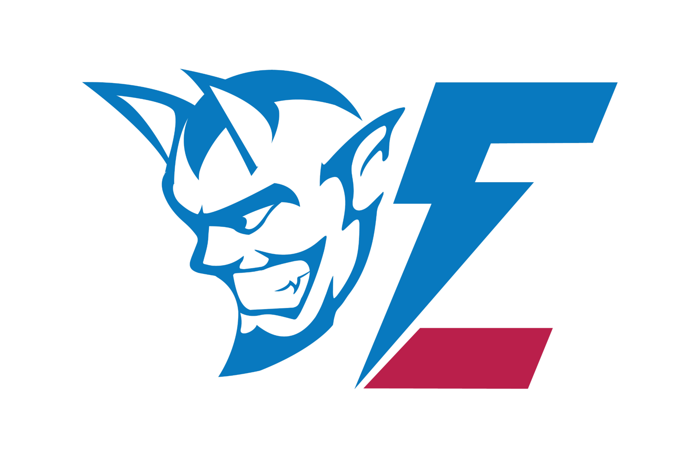
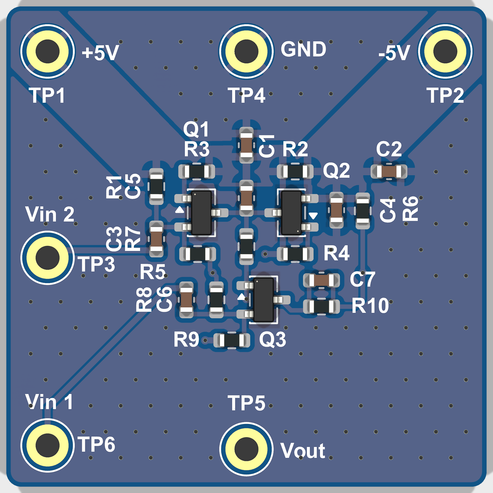
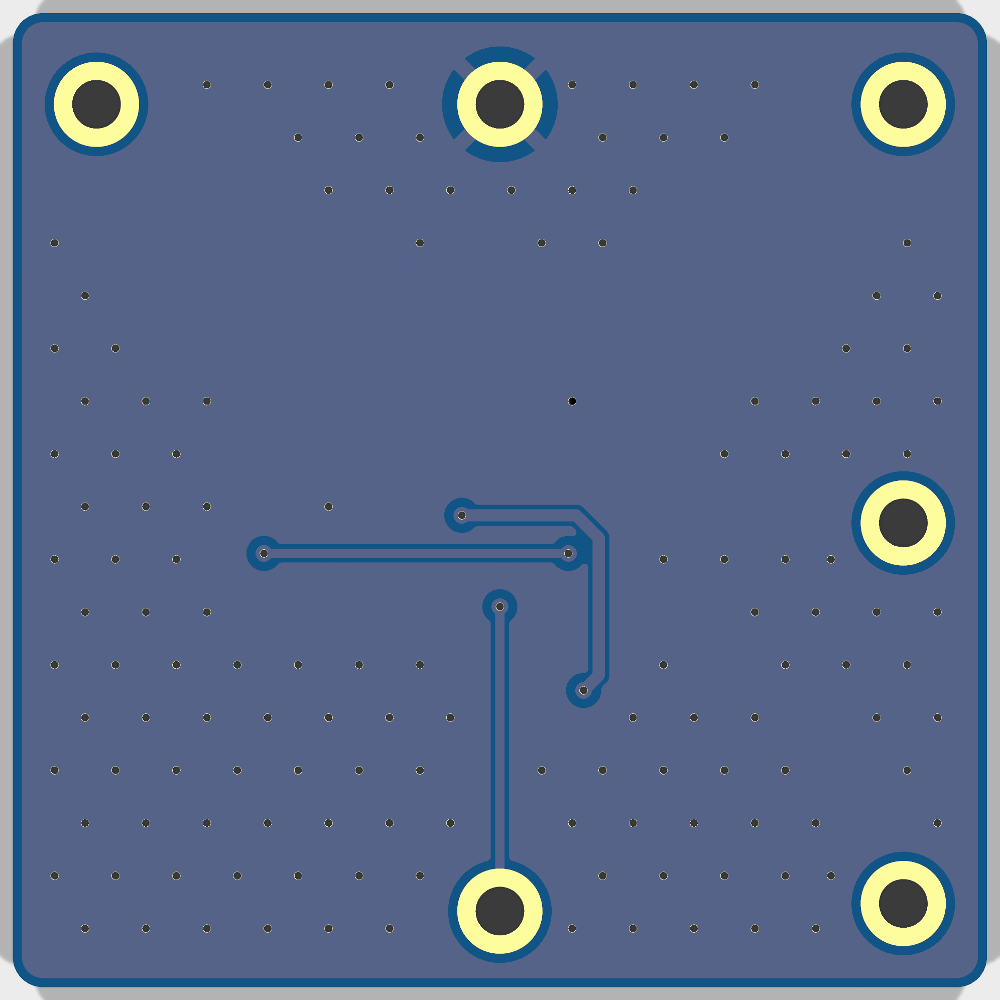

  

<h1 align="center">JONES_MIXER</h1>

Jones Mixer

<em>Simple Jones Mixer.</em>

  

    

***

  
&nbsp; &nbsp; &nbsp; &nbsp;
  

***

## SPECIFICATIONS

| Parameter | Value |
| --- | --- |
| Dimensions | 32.0 × 32.0 mm |
| Company | LTU |
| Designer | A.B., C.B., A.V. |
| Revision | 1.0.2 |
